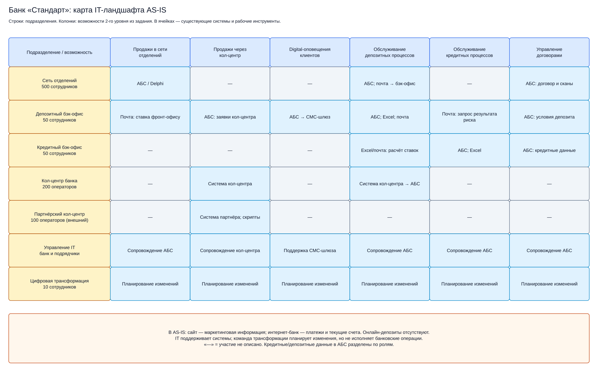
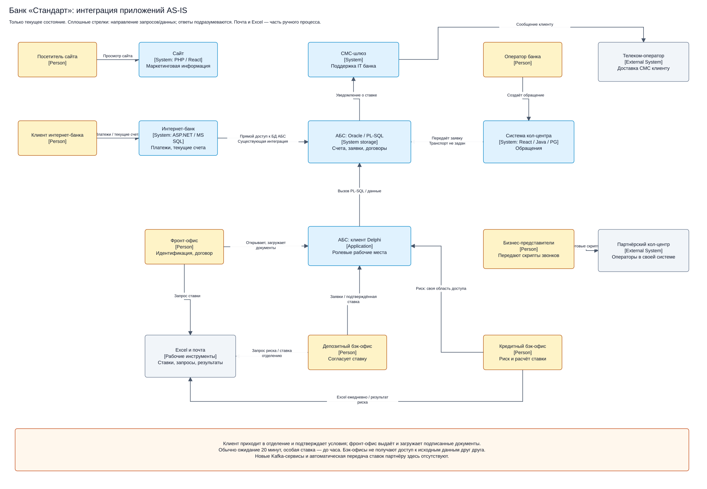

# Задание 1. Текущее состояние

## Карта IT-ландшафта

[Редактировать в draw.io](it-landscape-as-is.drawio)

Строки — подразделения, колонки — шесть бизнес-возможностей из задания. В ячейках указаны существующие системы. IT сопровождает системы, команда трансформации планирует изменения. Прочерк означает, что участие не описано.

Сайт пока содержит маркетинговую информацию, интернет-банк проводит платежи и открывает текущие счета. Онлайн-депозитов ещё нет.

## Интеграции

[Редактировать в draw.io](application-integration-as-is.drawio)

1. Кредитный бэк-офис рассчитывает ставки в Excel и отправляет депозитному бэк-офису по почте.
2. Кол-центр передаёт обращения в АБС. При обращении сразу в отделение фронт-офис запрашивает ставку письмом.
3. Бэк-офис согласует ставку, при необходимости запрашивает оценку кредитного риска, сохраняет результат в АБС.
4. АБС отправляет СМС через шлюз и телеком-оператора.
5. Фронт-офис открывает депозит и загружает подписанные документы в АБС.
6. Интернет-банк напрямую обращается к БД АБС для существующих операций. Партнёрский кол-центр получает готовые скрипты.

## Проблемы

Ручные расчёты, Excel и письма замедляют открытие: обычно клиент ждёт 20 минут, при особой ставке — до часа. Нет единого справочника ставок. АБС перегружена, а доступ двух бэк-офисов к данным друг друга ограничен.
